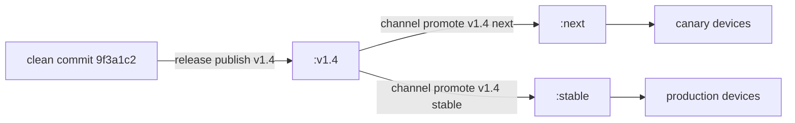

# Releases and channels

With a `[registry]`, bootcher publishes **releases** and moves **channels**. Both are tags
on one repository, `<registry>/<name>`.

- A **release** `:X` is any valid OCI tag you choose — `v1.4`, `2026.11`, `kiosk-r7`. It
  isn't tied to a git tag, though `release publish` can create one for you.
- A **channel** `:ch` is declared in `[registry] channels` and is always a byte-for-byte
  copy of some release. Devices follow channels, never releases directly. `latest` is
  not special: declare it to use it.



## What bootcher stamps

| Where | Key | Value |
|---|---|---|
| every member's image config (a label) | `bootcher.source` | the commit it was built from — stamped **only from a clean tree**, empty otherwise, so a dirty build can never pass for a release |
| every entry of the multi-arch index (an annotation on its descriptor) | `bootcher.release` | the release name, written when the index is assembled (the build never needs to know it). On the entries rather than the index itself, which podman before 5.0 can't annotate; they're part of the index's bytes either way |
| every member (labels + annotations) | `org.opencontainers.image.revision` / `.version` | `git rev-parse HEAD` (`-dirty`-suffixed) and `git describe --tags --always --dirty` — informational only; no logic reads them |
| every member (annotations, by buildah) | `org.opencontainers.image.base.name` / `.base.digest` | the base image and its per-arch digest at build time — what the [staleness check](base-patches.md) compares |

Lists are pushed as OCI indexes (`--format oci`), because Docker v2 lists carry no
annotations. A channel, being a copy of a release's index, carries the same `bootcher.release`
entries — which is how `channel status` knows what a channel serves.

## The one rule

**`:X` may only be written by a clean build of the commit its members record in
`bootcher.source`.** Everything follows from it:

- Publishing is idempotent: `release publish v1.4` on the commit `:v1.4` already
  records is a no-op ("already published at …"), so retries are free. `--rebuild`
  forces a rebuild of that same commit.
- A release never changes source: publishing `v1.4` from any other commit is refused.
  A git tag `v1.4` pointing elsewhere is refused too.
- Refreshes are legal: rebuilding `:X` from its recorded commit on a newer base
  re-pushes the same name with the same source — so `:X` names a *source*, not fixed
  bytes. For the exact old bytes, use `bootc rollback` on a device.
- A release published outside git records no source: it can be published once, and
  never overwritten or refreshed.

## Publishing

```sh
git commit -am "…" && bootcher release publish v1.4
```

`release publish` refuses a dirty tree, builds every arch from HEAD (or, with
`--skip-build`, takes the local `latest-<arch>` images — each must record HEAD),
assembles the index, refuses unless it holds exactly one member per `[targets]` arch,
annotates it and pushes it signed (with [signing](signing.md) on). Then, optionally,
`--git-tag push|local` creates an annotated git tag at HEAD, and `--promote <ch>` runs
the promote below. See [Publishing releases](../workflows/releases.md).

## Promoting

```sh
bootcher channel promote v1.4 stable
```

`channel promote` copies `:v1.4` onto `:stable` with `skopeo copy --all
--preserve-digests` (no rebuild, no re-sign: signatures are per-digest attachments, so
they apply to the copy) and prints the release `:stable` served before — the rollback
target. Before copying it checks:

- `:v1.4` exists ("publish it first" otherwise) and `stable` is declared;
- with signing on, `:v1.4` and every member carry a signature the configured key
  verifies;
- every member's base is the base's current digest; a stale or unreadable base is
  refused (point: `release refresh v1.4`) unless `--allow-stale-base`;
- `:stable` doesn't hold a release literally *named* `stable` (published before the
  channel was declared), which a promote would overwrite.

Then it runs the channel device step on the devices following `:stable`, always — even
when the channel didn't move, so a re-run retries the devices a failed run missed.
`--skip-remotes` skips it (devices pick the release up on their next timer run).

## Rolling back

- **Channel devices**: promote the previous release (`channel promote v1.3 stable`). If
  its base moved since, the promote refuses: `release refresh v1.3` first, then promote.
- **Direct devices**: `bootc rollback` on the device — direct devices keep no release
  history.

## Reading it back

```sh
bootcher release list                       # releases, their commit, base status, channels
bootcher channel status                     # what each channel serves, stale/lagging
bootcher device status                      # what each device runs
bootcher signing verify stable              # the signature a device would check
```

All four have `--format json` and a template form (`--format '{{ .Commit }}'`). On a
device, `bootc status` shows the booted image's digest and its `version` label; the full
label set is in `sudo ostree container image metadata --repo /sysroot/ostree/repo
--config <transport>:<image>`.
